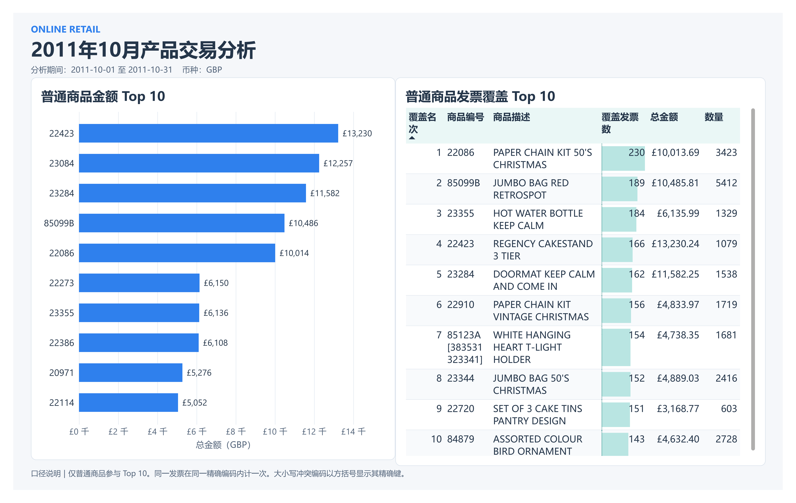

# UCI Online Retail｜2011 年 10 月交易分析

基于英国线上零售商的公开交易数据，比较市场规模与客户集中度、商品金额与发票覆盖，并找出下一轮优先核对的发票和商品。分析窗口为 `[2011-10-01, 2011-11-01)`。使用 Python、Pandas、MySQL、SQL 和 Power BI。

[经营复盘报告](reports/2011年10月经营复盘.md) · [业务证据与计算口径](reports/业务证据核验附录.md) · [市场看板](reports/figures/October_2011_Visual_01.png) · [商品看板](reports/figures/October_2011_Visual_02.png)

## 分析结果

- 10 月有 **57,834 行有效明细、2,040 张有效发票**，正向交易金额为 **GBP 1,148,101.10**。总额含非普通项，普通商品双榜单独排除 7 个非普通编码。
- 荷兰与澳大利亚的最大客户分别贡献本市场金额的 **98.25%** 与 **96.04%**。剔除澳大利亚金额最大的一张发票后，平均每张发票金额由 GBP 4,287.63 降至 GBP 502.25。
- 商品 `23084` 的前三张发票占该商品数量的 **67.56%**。市场和商品的复核清单按发票去重后为 **21 张**，另有 5 张手工项正负关联凭证待查。

## 目录

| 路径 | 内容 |
| --- | --- |
| `notebooks/` | 原始质量检查、清洗、入库、市场和商品分析及抽查 |
| `sql/` | 每日与市场指标、精确编码商品统计和排名 |
| `powerbi/` | PBIP 报表、语义模型及打开说明 |
| `data/outputs/` | 已核验的每日和市场汇总快照 |
| `reports/` | 经营复盘、证据附录、商品榜单、展示映射及截图 |

## 从原始 Excel 复现

按[数据下载说明](data_source.md#下载与校验)取得 `Online Retail.xlsx`，放入 `data/raw/`。原始工作簿和 `data/processed/` 的逐行交易文件在本地准备，公开目录包含复现所需的空目录和可供对照的汇总快照。

### 环境

- 使用 Python 3.10。本次在 Python 3.10.20 中运行了 02、06 和 09。直接依赖为 pandas 2.3.3、NumPy 2.2.6、openpyxl 3.1.5、SQLAlchemy 2.0.57、PyMySQL 1.2.4、python-dotenv 1.2.4 和 Jupyter Notebook 7.6.5，安装版本见 [requirements.txt](requirements.txt)。
- SQL 和 Power BI 复现需要支持 `utf8mb4_0900_ai_ci`、CTE 和窗口函数的 MySQL 8.x。本机安装的 MySQL 版本和已保存的入库 Notebook 连接输出均为 8.4.11。本次复跑使用本地文件。
- Power BI 使用支持 PBIP 的 Windows Power BI Desktop，实际使用版本需在目标机器确认。MySQL 数据源需要 Oracle MySQL Connector/NET，本机已安装 26.10.0，目标机器上的驱动版本及连接效果需确认。 [打开与刷新说明](powerbi/README.md)

在所选的 Python 环境中，从仓库根目录安装依赖，再进入 `notebooks/` 启动 Jupyter。该目录是 Notebook 解析相对路径与加载共用函数的起点。

~~~text
python -m pip install -r requirements.txt
cd notebooks
python -m notebook
~~~

### Python 与 MySQL 顺序

1. 运行 [01 质量检查](notebooks/01_data_quality_checks.ipynb) 和 [02 清洗](notebooks/02_clean_october_transactions.ipynb)，生成 `data/processed/data_10month.csv`。02 在隔离整行重复后记录并排除缺失发票号的行。
2. 运行 [04 市场分析](notebooks/04_analyze_markets.ipynb)、[06 商品描述处理](notebooks/06_prepare_product_data.ipynb)、[08 日汇总核验](notebooks/08_daily_checks_and_market_comparison.ipynb) 和 [09 核心结论核验](notebooks/09_verify_business_findings.ipynb)。04 刷新市场汇总，06 生成商品明细及待复核明细，09 用本地文件核对业务结论。以上步骤无需连接 MySQL。重新运行会覆盖对应的本地 CSV，可预先留存原快照供对照。
3. 需要复现 SQL 和 Power BI 时，先在本机 MySQL 复现环境创建项目数据库。以下语句只创建库，目标库已存在时会保留现有表。

   ~~~sql
   CREATE DATABASE IF NOT EXISTS data_10month
     CHARACTER SET utf8mb4 COLLATE utf8mb4_0900_ai_ci;
   ~~~

   复制 [config/.env.example](config/.env.example) 为本地 `config/.env`，用本机具备目标库权限的账号和密码替换占位值。也可以在启动 Jupyter 前提供同名环境变量。导入 Notebook 使用 `127.0.0.1:3306`。

   ~~~dotenv
   UCI_MYSQL_USER=your_local_user
   UCI_MYSQL_PASSWORD=your_local_password
   ~~~

4. 仅 [03 有效明细导入](notebooks/03_import_transactions_to_mysql.ipynb)、[05 市场汇总导入](notebooks/05_import_market_summary_to_mysql.ipynb) 和 [07 商品明细导入](notebooks/07_import_products_to_mysql.ipynb) 向 MySQL 写入数据。首次在空库按 03 → 05 → 07 运行。05 生成 `lavel2_country_copy`，SQL 和 Power BI 使用 `lavel2_country`。仅在确认目标表不存在时，将 05 新导入的表衔接为正式名称。

   ~~~sql
   RENAME TABLE data_10month.lavel2_country_copy TO data_10month.lavel2_country;
   ~~~

5. 在 `data_10month` 库中运行[每日与市场汇总](sql/01_daily_and_market_summary.sql)及[商品排名](sql/02_product_statistics_and_rankings.sql)，对照下方结果。

重复运行时，已有正确数据的库可直接执行查询和刷新看板。需要从新 CSV 全量重导时，先备份已有成果，在独立复现环境准备同名空库，再运行 03、05 和 07。共用写入函数遇到同名表会停止。07 会依次写两张表，若重试前已有其中一张，先确认上次完成到了哪一步。 [MySQL 写入函数](notebooks/mysql_import.py)

## 数据核验

- 对照[每日快照](data/outputs/October_day_retail.csv)、[市场汇总](data/outputs/data10_country.csv)和[商品排名对账](reports/商品排名与对账/商品排名对账.md)。每日快照无表头，列依次为 `sale_day`、`gross_amount_gbp` 和 `invoice_count`。
- 商品 SQL 的金额和发票覆盖名次分别取 1–10，与[金额榜](reports/商品排名与对账/普通商品_金额Top10.csv)及[发票覆盖榜](reports/商品排名与对账/普通商品_发票覆盖Top10.csv)对照。对账基准为 57,834 行、GBP 1,148,101.10、2,040 张发票、619,049 的数量合计和 2,854 个精确商品编码。
- 客户集中度、商品 `23084`、手工项正负凭证和缺客户标识的影响可运行 [09 核心结论核验](notebooks/09_verify_business_findings.ipynb) 检查。重复处理敏感性的核对口径见[业务证据附录](reports/业务证据核验附录.md#口径与计算方法)。

## Power BI

在 Windows Power BI Desktop 打开本地 [October_2011_Visual.pbip](powerbi/October_2011_Visual.pbip)。保留旁边的 Report 和 SemanticModel，并为本机 MySQL 提供连接凭据。随仓库提供的截图可直接浏览，换机后的数据刷新和 Tooltip 可按项目说明核对。 [打开与刷新说明](powerbi/README.md)

## 数据来源

Chen, D. (2015). *Online Retail*. UCI Machine Learning Repository。发布的数据快照经过日期筛选、交易清洗、描述处理和汇总。 [UCI 数据集与引用](https://archive.ics.uci.edu/dataset/352/online%2Bretail) · [CC BY 4.0](https://creativecommons.org/licenses/by/4.0/) · [下载、校验与字段说明](data_source.md)
