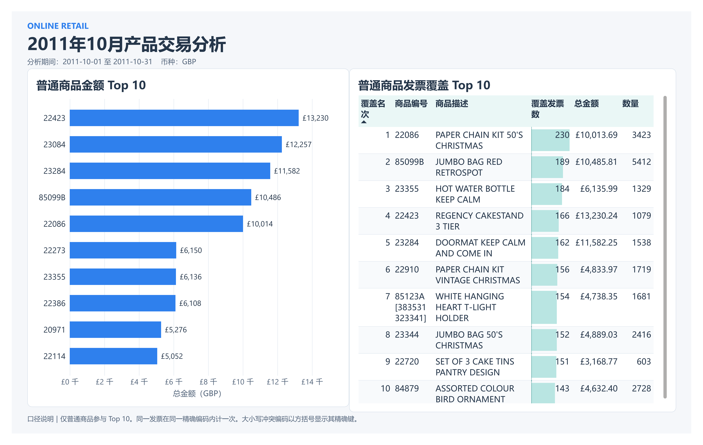

---

# 2011 年 10 月经营复盘｜市场集中、商品交易与异常复核

观察窗为 2011-10-01（含）至 2011-11-01（不含）。本报告用于判断下一轮应优先复核哪些客户、发票和商品。 [数据来源](../data_source.md)

## 1. 执行摘要

- **交易规模。** 26 个市场共有 57,834 行有效明细、2,040 张有效发票，正向交易金额为 **GBP 1,148,101.10**，含非普通项。英国占全月金额 **81.21%**、发票数 **88.77%**，用作规模比较基准。
- **荷兰与澳大利亚。** 荷兰客户 `14646` 贡献 **98.25%** 的市场金额，剔除最大一张发票后，平均每张仍为 GBP 1,459.34。澳大利亚客户 `12415` 贡献 **96.04%**，剔除最大一张后，平均每张由 GBP 4,287.63 降至 **GBP 502.25**。优先核对这两位客户的交易构成，客户类型待凭证确认。
- **商品 `23084`。** 6,323 件中有 **4,272 件（67.56%）** 集中在 3 张发票。荷兰的 `573003` 已在市场名单内，另外两张来自日本和法国。市场与商品范围合并后，按发票编号去重共 **21 张**。
- **手工项 `M`。** 新加坡一组发票相隔两分钟，出现 **GBP 6,068.06** 的正向金额与等额负向明细。法国一张负向发票的两件数量和 **GBP 8,322.12** 金额与两张正向发票对应。另查这两组原始凭证，确认关联性质后再作业务归类。 [证据与发票清单](业务证据核验附录.md)

## 2. 数据来源与质量处理

原始工作簿有 541,909 行、8 列。用原始 8 列识别整行重复，暂按整组隔离，再依次排除取消明细与数量或单价非正的明细。10 月窗口行数依次为 60,742 → 59,260 → 58,072 → 57,834，三步排除 1,482、1,188、238 行。发票号和商品编码在该窗口内均无缺失。有效行金额为 `Quantity × UnitPrice`，金额以 GBP 报告。发票数按当期范围内的 `InvoiceNo` 去重。正向总览包含非普通项，普通商品排名另排除 7 个非普通编码。 [数据下载与校验](../data_source.md#下载与校验) · [数据质量检查](../notebooks/01_data_quality_checks.ipynb) · [清洗 Notebook](../notebooks/02_clean_october_transactions.ipynb) · [10 月有效明细（本地生成）](../data_source.md#本地生成文件)

### 重复记录处理敏感性

日期、取消及正数量和正单价条件相同，只改变原始 8 列完全重复记录的处理方式。

| 重复处理方式     | 有效行数   | 正向金额（GBP）    |
| ---------- | ------:| ------------:|
| 整组隔离（当前口径） | 57,834 | 1,148,101.10 |
| 每组保留一条     | 58,537 | 1,151,263.73 |
| 不处理重复      | 59,304 | 1,154,979.30 |

原始窗口共有 1,482 行属于重复组，其中 **773 行**是每组首条之外的记录。最终有效明细中，每组留一条比整组隔离多 **703 行**，不处理比每组留一条多 **767 行**。703 和 767 均按筛选后的有效交易计算，773 则在原始窗口直接计数。每组留一条比当前口径高 GBP 3,162.63，以当前正向总额为分母约为 **0.28%**。完全相同的明细有可能对应真实交易，整组隔离和只留一条均是分析假设，主报告沿用已核验的整组隔离口径。 [计算分母和对账](业务证据核验附录.md#口径与计算方法)

异常可重叠，下表的比例以去重前的 60,742 行原始窗口明细为分母。

| 检查项                         | 原始窗口行数      | 占原始窗口  | 处理说明                              |
| --------------------------- | -----------:| ------:| --------------------------------- |
| `InvoiceNo` 以 C 开头的取消明细     | 1,200       | 1.98%  | 隔离整行重复组后，取消步骤再排除 1,188 行          |
| 负数量                         | 1,346       | 2.22%  | 取消 1,200 行、非取消 146 行。各步排除量按清洗顺序另计 |
| 非正价格                        | 零价 238，负价 0 | 0.39%  | `UnitPrice` 为零的明细随非正数量或价格条件排除     |
| 缺 `CustomerID`              | 10,047      | 16.54% | 满足其余条件的明细保留，有效明细内缺 9,738 行        |
| 缺 `Description`             | 104         | 0.17%  | 缺描述本身不作为排除条件。商品按 `StockCode` 聚合   |
| 整行重复组成员                     | 1,482       | 2.44%  | 按原 8 列识别，每组首条以外的重复行共 773 行        |
| 缺 `InvoiceNo` 或 `StockCode` | 0           | 0.00%  | 本窗口未发现缺失                          |

## 3. 交易规模与每日趋势

本月有效明细 57,834 行，正向金额 GBP 1,148,101.10，有效发票 2,040 张。`Quantity` 合计 619,049，含非普通编码对应的记录数量。逐日数据覆盖 31 个自然日，含 5 个零交易日。下表按自然周汇总，首尾两周只含窗口内日期。 [日汇总 CSV](../data/outputs/October_day_retail.csv)

| 周期                      | 正向金额（GBP）        | 有效发票（张）   | 备注                                     |
| ----------------------- | ----------------:| ---------:| -------------------------------------- |
| 2011-10-01 至 2011-10-02 | 11,428.59        | 35        | 2011-10-01 周六无交易；2011-10-02 周日为窗内首个交易日 |
| 2011-10-03 至 2011-10-09 | 318,237.27       | 494       | 2011-10-08 周六无交易                       |
| 2011-10-10 至 2011-10-16 | 227,306.09       | 456       | 2011-10-15 周六无交易                       |
| 2011-10-17 至 2011-10-23 | 275,318.94       | 453       | 2011-10-22 周六无交易                       |
| 2011-10-24 至 2011-10-30 | 258,524.46       | 530       | 2011-10-29 周六无交易                       |
| 2011-10-31              | 57,285.75        | 72        | 仅周一                                    |
| **合计**                  | **1,148,101.10** | **2,040** | 与全月核验一致                                |

5 个周六的有效交易均为零。周日日均金额为 **GBP 18,242.97**，同期周一至周五为 **GBP 50,327.92**。金额最高的一天是 **2011-10-05（GBP 75,331.25）**，发票数最多的一天是 **2011-10-06（122 张）**。 [日汇总](../data/outputs/October_day_retail.csv)

这些发现适用于本月观察窗。10 月有圣诞主题商品位居榜前，季节性仍需更长时期数据验证。

## 4. 市场表现

本节使用全量有效明细，包含已单列的非普通项。金额、去重发票数和平均每张发票金额均按各市场计算。

| 市场              | 正向金额（GBP）        | 有效发票（张）   | 平均每张发票（GBP） | 金额占比    |
| --------------- | ----------------:| ---------:| -----------:| -------:|
| United Kingdom  | 932,383.66       | 1,811     | 514.84      | 81.21%  |
| Netherlands     | 40,708.65        | 15        | 2,713.91    | 3.55%   |
| France          | 33,456.65        | 35        | 955.90      | 2.91%   |
| Germany         | 31,618.42        | 58        | 545.15      | 2.75%   |
| EIRE            | 24,287.92        | 31        | 783.48      | 2.12%   |
| Australia       | 17,150.53        | 4         | 4,287.63    | 1.49%   |
| Spain           | 8,636.94         | 8         | 1,079.62    | 0.75%   |
| Switzerland     | 8,036.28         | 8         | 1,004.54    | 0.70%   |
| Singapore       | 7,067.32         | 2         | 3,533.66    | 0.62%   |
| Portugal        | 6,164.32         | 10        | 616.43      | 0.54%   |
| Sweden          | 5,766.16         | 3         | 1,922.05    | 0.50%   |
| Belgium         | 5,685.38         | 11        | 516.85      | 0.50%   |
| Cyprus          | 4,287.77         | 4         | 1,071.94    | 0.37%   |
| Norway          | 3,687.23         | 7         | 526.75      | 0.32%   |
| Italy           | 3,489.69         | 7         | 498.53      | 0.30%   |
| Finland         | 2,822.12         | 6         | 470.35      | 0.25%   |
| Channel Islands | 2,623.32         | 5         | 524.66      | 0.23%   |
| USA             | 2,311.20         | 2         | 1,155.60    | 0.20%   |
| Japan           | 1,948.04         | 2         | 974.02      | 0.17%   |
| Denmark         | 1,490.76         | 3         | 496.92      | 0.13%   |
| Iceland         | 1,294.32         | 1         | 1,294.32    | 0.11%   |
| Austria         | 1,043.78         | 1         | 1,043.78    | 0.09%   |
| RSA             | 1,002.31         | 1         | 1,002.31    | 0.09%   |
| Hong Kong       | 734.52           | 2         | 367.26      | 0.06%   |
| Czech Republic  | 277.48           | 1         | 277.48      | 0.02%   |
| Israel          | 126.33           | 2         | 63.17       | 0.01%   |
| **合计**          | **1,148,101.10** | **2,040** | **562.79**  | 100.00% |

- UK 占金额 **81.21%**、发票 **88.77%**。非 UK 金额前五为荷兰、法国、德国、EIRE、澳大利亚。非 UK 市场中，德国发票数最多（58 张），荷兰金额最高（GBP 40,708.65）。UK 平均每张发票金额低于全月均值，用作规模比较基准。复核优先级依据交易集中和凭证不确定性。
- 澳大利亚、新加坡和荷兰的平均每张发票金额分列前三，分别为 GBP 4,287.63、GBP 3,533.66 和 GBP 2,713.91，有效发票分别是 4、2、15 张。发票数较少时，个别发票金额会较明显地影响均值。发票与客户集中度见第 5 节。
- 德国平均每张 GBP 545.15，接近 UK 的 GBP 514.84。法国为 GBP 955.90，约为 UK 的 1.86 倍。瑞典只有 3 张发票，平均每张 GBP 1,922.05。客户类型需要另行核实。 [市场汇总](../data/outputs/data10_country.csv)

### 普通商品范围对照

以普通商品明细重算金额，分母为该市场至少含一条普通商品明细的去重发票。荷兰移出 GBP 330.00 的非普通项后，金额为 GBP 40,378.65、14 张、平均 GBP 2,884.19。澳大利亚没有这 7 类编码，仍为 GBP 17,150.53、4 张、平均 GBP 4,287.63。两者仍适合优先复核。法国和德国的非 UK 金额名次发生互换，比较时需注明范围。 [10 月有效明细（本地生成）](../data_source.md#本地生成文件) · [榜外编码](商品排名与对账/榜外非普通项.csv)

### Power BI 市场页

总额卡片现标为「正向交易金额（含非普通项）」。截图中的 GBP 1,148,101.10、2,040 张有效发票、GBP 562.79 每张及 26 个市场与报告一致。每日图用柱形展示金额、折线展示发票数，覆盖 31 个自然日。市场金额和发票榜各有含英国及排除英国的版本。 [Power BI 项目](../powerbi/October_2011_Visual.pbip) · [市场汇总](../data/outputs/data10_country.csv)

图 1 · 英国体量较大，含英国图中部分较短的柱形标签被省略，精确值可查本节市场表。含英国的发票榜在 7 张处并列，同时显示意大利和挪威，截图实际有 11 个市场。

## 5. 客户交易集中度

### 市场交易集中度与客户结构分析

两国的有效明细均有客户标识。客户数为各市场内非缺失 `CustomerID` 去重数。先按市场和发票汇总正向金额，再比较均值、中位数和移除最大一张发票后的均值。

| 指标                  | Netherlands | Australia |
| ------------------- | -----------:| ---------:|
| 正向交易金额（GBP）         | 40,708.65   | 17,150.53 |
| 有效发票（张）             | 15          | 4         |
| 已识别客户（个）            | 4           | 2         |
| 金额最大客户              | `14646`     | `12415`   |
| 该客户交易金额（GBP）        | 39,995.95   | 16,471.77 |
| 该客户贡献的发票（张）         | 12          | 2         |
| 该客户占对应市场金额          | 98.25%      | 96.04%    |
| 最大金额发票              | `572035`    | `569650`  |
| 最大一张金额（GBP）         | 20,277.92   | 15,643.77 |
| 最大一张占对应市场金额         | 49.81%      | 91.21%    |
| 平均每张发票金额（GBP）       | 2,713.91    | 4,287.63  |
| 发票金额中位数（GBP）        | 788.16      | 708.48    |
| 排除最大一张后的平均发票金额（GBP） | 1,459.34    | 502.25    |

- **荷兰。** `14646` 同时是最大金额发票 `572035` 和 `23084` 最大数量发票 `573003` 的客户。排除 `572035` 后，剩余 14 张发票的均值仍高于原中位数。应同时检查这位客户的其他大额发票，而非只看最大一张。
- **澳大利亚。** 仅 4 张发票，`569650` 占市场金额 91.21%。移出该票后，3 张发票的均值落到 GBP 502.25，低于原中位数 GBP 708.48。本月按均值看似很高，主要由这张发票拉高。

两国在本观察窗内的交易金额均高度集中于单一客户。是否为批发业务需客户主数据和订单凭证确认；单月集中程度不足以判断长期依赖或客户流失风险。 [10 月有效明细（本地生成）](../data_source.md#本地生成文件) · [19 张发票清单](业务证据核验附录.md#市场复核发票清单)

### 客户标识缺失的影响

| 指标                     | 数量或金额          | 占有效范围  |
| ---------------------- | --------------:| ------:|
| 缺 `CustomerID` 的明细     | 9,738 行        | 16.84% |
| 缺 `CustomerID` 的明细金额   | GBP 115,582.05 | 10.07% |
| 至少一行缺 `CustomerID` 的发票 | 111 张          | 5.44%  |

比例分别以有效明细行数、有效正向金额、有效去重发票数为分母。16.84% 描述的是行占比。客户标识缺失会限制全月客户级集中度和客户数估计，对应交易行通过其他有效条件后仍计入金额与发票统计。 [10 月有效明细（本地生成）](../data_source.md#本地生成文件) · [计算分母](业务证据核验附录.md#口径与计算方法)

## 6. 商品表现与编码限制

商品底表按大小写敏感的精确编码聚合，共 2,854 个精确商品编码，业务上实际有多少不同商品仍待主数据确认。普通商品排名池包含 2,847 个编码、57,604 行、GBP 1,100,223.62、617,665 件。同一张发票可以覆盖多个商品，覆盖数在每个商品内去重。两榜按指标降序，同值按精确键升序。 [商品统计 SQL](../sql/02_product_statistics_and_rankings.sql) · [全量对账](商品排名与对账/商品排名对账.md)

### 金额 Top 10

[结果表](商品排名与对账/普通商品_金额Top10.csv)

| `StockCode` | 展示名称                              | 正向金额（GBP） | 销量（件） | 发票覆盖（张） |
| ----------- | --------------------------------- | ---------:| -----:| -------:|
| `22423`     | REGENCY CAKESTAND 3 TIER          | 13,230.24 | 1,079 | 166     |
| `23084`     | RABBIT NIGHT LIGHT                | 12,256.87 | 6,323 | 73      |
| `23284`     | DOORMAT KEEP CALM AND COME IN     | 11,582.25 | 1,538 | 162     |
| `85099B`    | JUMBO BAG RED RETROSPOT           | 10,485.81 | 5,412 | 189     |
| `22086`     | PAPER CHAIN KIT 50'S CHRISTMAS    | 10,013.69 | 3,423 | 230     |
| `22273`     | FELTCRAFT DOLL MOLLY              | 6,149.70  | 2,450 | 43      |
| `23355`     | HOT WATER BOTTLE KEEP CALM        | 6,135.99  | 1,329 | 184     |
| `22386`     | JUMBO BAG PINK POLKADOT           | 6,107.68  | 3,206 | 101     |
| `20971`     | PINK BLUE FELT CRAFT TRINKET BOX  | 5,276.38  | 4,870 | 63      |
| `22114`     | HOT WATER BOTTLE TEA AND SYMPATHY | 5,051.51  | 905   | 138     |

### 发票覆盖 Top 10

[结果表](商品排名与对账/普通商品_发票覆盖Top10.csv)

| `StockCode` | 展示名称                               | 发票覆盖（张） | 正向金额（GBP） | 销量（件） |
| ----------- | ---------------------------------- | -------:| ---------:| -----:|
| `22086`     | PAPER CHAIN KIT 50'S CHRISTMAS     | 230     | 10,013.69 | 3,423 |
| `85099B`    | JUMBO BAG RED RETROSPOT            | 189     | 10,485.81 | 5,412 |
| `23355`     | HOT WATER BOTTLE KEEP CALM         | 184     | 6,135.99  | 1,329 |
| `22423`     | REGENCY CAKESTAND 3 TIER           | 166     | 13,230.24 | 1,079 |
| `23284`     | DOORMAT KEEP CALM AND COME IN      | 162     | 11,582.25 | 1,538 |
| `22910`     | PAPER CHAIN KIT VINTAGE CHRISTMAS  | 156     | 4,833.97  | 1,719 |
| `85123A`    | WHITE HANGING HEART T-LIGHT HOLDER | 154     | 4,738.35  | 1,681 |
| `23344`     | JUMBO BAG 50'S CHRISTMAS           | 152     | 4,889.03  | 2,416 |
| `22720`     | SET OF 3 CAKE TINS PANTRY DESIGN   | 151     | 3,168.77  | 603   |
| `84879`     | ASSORTED COLOUR BIRD ORNAMENT      | 143     | 4,632.40  | 2,728 |

### 榜外非普通项

共 7 个编码、230 行、GBP 47,877.48，`Quantity` 合计 1,384。 [榜外非普通项](商品排名与对账/榜外非普通项.csv)

| 编码             | 说明                | 金额（GBP）   | 发票覆盖（张） |
| -------------- | ----------------- | ---------:| -------:|
| `M`            | Manual（手工项，未标明商品） | 21,116.67 | 40      |
| `DOT`          | DOTCOM POSTAGE    | 17,955.13 | 43      |
| `POST`         | POSTAGE           | 8,025.96  | 126     |
| `C2`           | CARRIAGE          | 700.00    | 14      |
| `BANK CHARGES` | Bank Charges      | 30.00     | 2       |
| `S`            | SAMPLES           | 33.05     | 1       |
| `gift_0001_20` | 礼品券 GBP 20        | 16.67     | 1       |

以下为核对凭证时可参考的明细行数和单价范围。

| 编码             | 行数  | 单价范围（GBP）     |
| -------------- | ---:| ------------- |
| `M`            | 43  | 0.08–4,161.06 |
| `DOT`          | 43  | 3.29–2,019.05 |
| `POST`         | 126 | 0.55–240.00   |
| `C2`           | 14  | 50.00         |
| `BANK CHARGES` | 2   | 15.00         |
| `S`            | 1   | 33.05         |
| `gift_0001_20` | 1   | 16.67         |

- 金额榜第 10 位 `22114` 与第 11 位无并列。`20971` 的销量为 4,870 件、发票覆盖为 63 张。
- 两张榜共同上榜 5 个编码，分别为 22086、22423、23284、23355、85099B。仅金额榜包含 20971、22114、22273、22386、23084；仅覆盖榜包含 22720、22910、23344、84879、85123A。
- 23084 仅上金额榜，6,323 件分布在 73 张发票，平均每张约 86.6 件，平均每件金额约 GBP 1.94。22720 仅上覆盖榜，151 张发票平均约 4.0 件，平均每件金额约 GBP 5.26。两个例子在发票覆盖范围和每张购买数量上差别明显。
- M 在 7 个榜外编码中金额最高，描述只标示手工项，具体用途需查凭证。62 个编码存在描述冲突，44 个采用暂定主描述，18 个保留待复核标签。标签仅用于展示，对应编码的金额、销量和覆盖数沿用原统计。 [榜外非普通项](商品排名与对账/榜外非普通项.csv) · [描述候选及频次](商品排名与对账/冲突描述候选及频次.csv)

### 编码和描述仍需业务确认

| 精确编码     | 原始描述                               | 金额（GBP）  | 发票覆盖（张） |
| -------- | ---------------------------------- | --------:| -------:|
| `85123A` | WHITE HANGING HEART T-LIGHT HOLDER | 4,738.35 | 154     |
| `85123a` | WHITE HANGING HEART T-LIGHT HOLDER | 86.19    | 5       |

两条编码虽然描述相同，目前按精确键各自统计。商品主数据确认身份后，若需合并，按合并范围重新对 `InvoiceNo` 去重计算覆盖数。44 个暂定主描述和 18 个待复核编码来自现有数据处理，仍需商品主数据核定。 [10 月有效明细（本地生成）](../data_source.md#本地生成文件) · [展示映射](商品排名与对账/商品展示映射.csv)

### Power BI 商品页

普通商品金额柱形图和发票覆盖表均按对应的 SQL 名次筛选第 1–10 位。截图中，金额第一为 `22423`，覆盖第一为 `22086`（230 张）。`85123A` 在覆盖榜显示带精确键的标签，仍按原大小写区分编码。 [Power BI 项目](../powerbi/October_2011_Visual.pbip) · [商品排名对账](商品排名与对账/商品排名对账.md)

图 2 · 金额图标签取整，精确金额以报告表格和 CSV 为准。项目保留隐藏的产品编码详情 Tooltip 页。两张截图证实页面展示，Desktop 重新连接刷新和实际悬浮显示待核验。

## 7. 客户—发票—商品交叉分析

### 商品与客户交叉分析

`23084`（RABBIT NIGHT LIGHT）金额第 2，共 GBP 12,256.87、6,323 件，覆盖 73 张发票。按该编码在发票中的数量汇总后，前三张合计 4,272 件，占 **67.56%**。下表金额仅计 `23084` 行。

| 发票与日期                 | 市场与客户                 | 数量（件）     | 商品金额（GBP）    |
| --------------------- | --------------------- | ---------:| ------------:|
| `573003` · 2011-10-27 | Netherlands · `14646` | 2,400     | 4,992.00     |
| `572869` · 2011-10-26 | Japan · `12798`       | 960       | 1,718.40     |
| `573153` · 2011-10-28 | France · `12678`      | 912       | 1,632.48     |
| **合计**                | —                     | **4,272** | **8,342.88** |

荷兰的 `573003` 单票占该商品销量 37.96%，且归属于荷兰最大金额客户，已在其 15 张市场复核发票中。日本和法国的两张发票列入商品专项。其中法国发票含其他商品行，复核商品时用上表的 GBP 1,632.48，整票金额 GBP 8,895.76 单独记录。

上述发票的数量集中是抽查依据。先核对计量单位、原始订单和出货凭证，再判断记录是否符合订单背景或客户需求。 [10 月有效明细（本地生成）](../data_source.md#本地生成文件) · [金额 Top 10](商品排名与对账/普通商品_金额Top10.csv) · [明细核验](业务证据核验附录.md#商品专项证据)

### 其他交叉结果

- 双榜共同的 5 个编码中，UK 占各编码金额的比例介于 65.30% 至 97.78%，按每个编码的全部有效金额计算。
- 在非 UK 待复核描述子集中，描述包含 WALL ART 的明细占该子集非 UK 金额的 92.37%；在全部非 UK 有效明细中占 2.70%。两项各自使用对应范围的非 UK 金额作分母。 [10 月有效明细（本地生成）](../data_source.md#本地生成文件) · [待复核明细（本地生成）](../data_source.md#本地生成文件)

## 8. 取消及异常交易复核

在隔离前的 60,742 行原始窗口内，1,200 行的发票号以 C 开头，全部为负数量。负数量共 1,346 行，其中 146 行来自未标取消的发票。两类记录有重叠，先保留为异常复核证据。正向经营总览继续沿用第 2 节的有效明细口径。 [数据下载与校验](../data_source.md#下载与校验) · [数据质量检查](../notebooks/01_data_quality_checks.ipynb)

### M（Manual）手工项性质及取消、重开关系复核

以下为从原始工作簿定位的 `M` 明细，金额为带符号的 `Quantity × UnitPrice` 之和。时间均为源文件记录时间。

**新加坡 · 客户 `12744`**

| 发票        | 记录时间             | 性质      | 金额（GBP）   |
| --------- | ---------------- | ------- | ---------:|
| `C571750` | 2011-10-19 11:16 | C 前缀、负向 | -6,068.06 |
| `571751`  | 2011-10-19 11:18 | 正向      | 6,068.06  |

**法国 · 客户 `12536`**

| 发票        | 记录时间             | 性质      | 金额（GBP）   |
| --------- | ---------------- | ------- | ---------:|
| `573077`  | 2011-10-27 14:13 | 正向      | 4,161.06  |
| `C573079` | 2011-10-27 14:15 | C 前缀、负向 | -8,322.12 |
| `573080`  | 2011-10-27 14:20 | 正向      | 4,161.06  |

- **新加坡。** 两张发票相隔两分钟。单价 GBP 3,949.32 和 GBP 2,118.74 在两张票上分别出现一次，每个价格的数量由 -1 对应 +1。核对取消原因以及两张票在订单系统中的关联。
- **法国。** 三张票单价均为 GBP 4,161.06，数量依时间为 +1、-2、+1。核对负向票关联了哪张或哪些原票，以及最后一张正向票的业务用途。

这两组的正向票合计 GBP 14,390.18，占全月 `M` 正向金额 GBP 21,116.67 的 68.15%。两组记录在客户、编码、价格、带符号金额和时间上高度对应，正式关联需原始凭证、发票记录和业务说明确认。退款、重复开票和重新开票均是待验证的可能解释。负向金额仅作独立复核证据，现有数据不足以确认退款金额或当月净收入。 [七条原始行与金额核验](业务证据核验附录.md#手工项逐行证据)

## 9. 优先复核对象与行动计划

短名单按要解决的问题组织。涉及金额决定潜在影响，集中程度决定从哪些发票入手，业务凭证和主数据决定能否定性。

### A. 市场与客户集中度复核

- **Netherlands。** 市场 GBP 40,708.65，`14646` 占 98.25%。复核全部 15 张，先核对该客户的 12 张，拆分商品与费用并确认交易类型。
- **Australia。** 市场 GBP 17,150.53，`12415` 占 96.04%，最大一张占 91.21%。复核全部 4 张，先核对 `569650` 的金额、数量及客户类型。

德国、法国和 EIRE 可留作规模结构的第二轮对照。英国保留为全月规模参照。 [市场结果](../data/outputs/data10_country.csv) · [19 张发票清单](业务证据核验附录.md#市场复核发票清单)

### B. 交易凭证与异常复核

- **Singapore / `M`。** 等额正负记录各 GBP 6,068.06，相隔两分钟。2 张发票和 4 条原始行，对照取消原因、原票关系及后续交易。
- **France / `M`。** 两张正向票各 GBP 4,161.06，一张负向票 -GBP 8,322.12。3 张发票和 3 条原始行，查凭证确认负向票及两张正向票的关系。
- **18 个待复核编码。** 涉及 586 行、GBP 22,509.27，多种描述仍并存。先按 18 个精确编码逐项核对商品主数据和候选频次，有歧义再追溯明细。

[原始交易与候选证据](业务证据核验附录.md) · [待复核明细（本地生成）](../data_source.md#本地生成文件) · [候选描述及频次](商品排名与对账/冲突描述候选及频次.csv)

### C. 商品数量集中度复核

- **`23084`。** 前三张发票 4,272 件，占 67.56%，对应商品金额 GBP 8,342.88。核对 3 张发票中的商品行及计量单位，其中 1 张沿用市场复核，另加 2 张。
- **`85123A` / `85123a`。** 各自金额为 GBP 4,738.35 和 GBP 86.19，描述相同、编码大小写不同。先核对 2 条商品主数据及编码沿革，确认身份后再决定是否按合并范围重算发票覆盖。

### 发票范围与记录方式

- 市场范围为荷兰 15 张和澳大利亚 4 张，合计 19 张。`23084` 专项与市场范围交集仅 `573003`，再加入 `572869`、`573153`，合计 **21 张不同的有效发票**。
- 两组 `M` 共 5 张指定发票，与上述 21 张无重叠。三条方向当前指定 **26 张不同的发票凭证**，其中 2 张为负向。描述和大小写身份以编码为单位另跟踪，不预先计入发票工作量。 [复核清单](业务证据核验附录.md)

分析师按发票整理明细，经营负责人协助取得订单、出货、取消凭证和商品、客户主数据。单票涉及多个商品时按发票与精确编码记录，需要时附行号。大额交易、批发与异常可以同时出现；证据不足则标为待核实，保留未解释金额。

- `InvoiceNo` / `Country` / `CustomerID` · 发票编号、市场、客户编号；客户标识缺失时注明。
- `StockCode` / `Quantity` · 精确商品编码、带符号数量及核实后的计量单位。
- `Amount` · 当前记录范围的带符号金额（GBP），注明指整票还是商品行。
- `RelatedCancellation` · 可能关联或已证实关联的负向发票编号，标明关系确认状态。
- `Evidence` · 原票、订单、出货、业务说明或主数据的凭证索引。
- `ExplainedAmount` / `UnexplainedAmount` · 在同一记录范围、同一符号口径下拆分，合计应与 `Amount` 对账。
- `Conclusion` / `Status` · 记录获得凭证后能确认的事实、尚缺证据及状态（待核实／部分确认／已确认）。

## 10. 局限性与后续验证

| 问题         | 为什么现有数据不能回答                            | 需要补充的数据         |
| ---------- | -------------------------------------- | --------------- |
| 利润/毛利如何    | 原表无成本字段，仅有售价与数量                        | 成本、费用、物流成本      |
| 促销/流量/转化影响 | 原表无流量与促销字段                             | 流量、转化、活动记录      |
| 退货/取消原因    | 仅有交易记录（C 开头/负数量），无原因字段                 | 退货原因、客服/工单记录    |
| 是否为批发客户    | 无客户类型标签，且有效明细有 16.84% 的行缺 `CustomerID` | 客户类型、客户主数据      |
| 经营问题原因     | 观察性交易数据不足以做因果判断                        | 实验设计或业务复核       |
| 大额发票的业务性质  | 交易明细可以拆出金额、数量和费用。批发、打包等业务解释需要额外证据      | 发票核查、客户主数据、业务凭证 |

### 用 `[`2011-11-01 , 2011-12-01`)` 的数据复核

使用一致的日期、有效交易、精确编码和聚合口径，分别检查客户 `14646`、`12415` 是否再次出现大额交易，`23084` 的数量是否仍集中在少数发票，两个市场的最大客户占比是否持续，以及 `M` 是否再次出现可疑正负对应。负向重复出现仅支持继续追踪，原因和正式关联仍需业务凭证。一个月的记录也不足以证明客户行为长期稳定。缺客户标识或待复核描述对市场排序的额外影响尚未验证。

## 11. 技术实现与复现说明

### 技术栈

| 技术              | 实际用途                                        |
| --------------- | ------------------------------------------- |
| Python / Pandas | 读取 Excel、检查数据质量、清洗交易、按国家汇总、处理商品描述及抽查结果      |
| MySQL           | 存储有效交易、国家汇总和商品明细，为 SQL 和 Power BI 提供数据      |
| SQL             | 补齐 10 月日历并按天聚合，查询国家汇总，按精确商品编码聚合、统计去重发票覆盖并排名 |
| Power BI        | 展示每日趋势、市场对照和两张普通商品 Top 10；配置产品编码详情 Tooltip  |

当前 PBIP 默认打开市场页。每日汇总表的金额、发票数，以及市场汇总表的金额、发票数和平均发票金额均设为默认不汇总。现有视觉仍按自己的查询配置取数，市场平均发票金额出现在发票榜的单市场 Tooltip 中。

### 两处函数复用

- `write_dataframe_to_mysql(dataframe, table_name, engine)` 集中维护重复的 Pandas 写入参数，沿用各 Notebook 建立的 SQLAlchemy Engine。03、05 和 07 共调用 4 次，例如 `write_dataframe_to_mysql(df, "lavel2", engine)`。固定使用 `if_exists="fail"`、`index=False`、`chunksize=1000`、`method="multi"`，返回写入行数或 `None`。表名、连接方式和写入行为沿用原实现。 [共用导入函数](../notebooks/mysql_import.py)
- `check_description_conflicts(data, description_column, count_column)` 在 Notebook 06 中按精确编码检测描述冲突，返回规范化候选及频次。频次占比按原规则保留三位小数，最高频候选占比达到 70% 且该码至少有 5 条可用描述时，选用该候选对应的原始写法。全量有效明细单独聚合商品事实，以 `assert_frame_equal` 核对映射后和入库明细重聚合后的结果。历史重构前的完整中间表未随项目保存。Notebook 09 可重新计算候选频次，对照保存的候选和双榜快照。 [商品明细与描述处理](../notebooks/06_prepare_product_data.ipynb) · [核心结论核验](../notebooks/09_verify_business_findings.ipynb)

### 从原始 Excel 复现

从 `notebooks/` 启动内核，数据库和运行环境按[项目 README](../README.md#从原始-excel-复现)准备。空库复现需把 05 生成的 `lavel2_country_copy` 衔接到市场 SQL 和 Power BI 使用的 `lavel2_country`。

1. **质量检查与清洗。** [数据下载与校验](../data_source.md#下载与校验) → [01 质量检查](../notebooks/01_data_quality_checks.ipynb) → [02 清洗](../notebooks/02_clean_october_transactions.ipynb)。质量检查输出和[10 月有效明细（本地生成）](../data_source.md#本地生成文件)，供 03、04、06、08 读取。

2. **市场与每日汇总。** 03 导入有效明细；04 从有效明细产出国家汇总；05 导入该 CSV。准备好两张表后运行[每日与市场 SQL](../sql/01_daily_and_market_summary.sql)。[国家汇总 CSV](../data/outputs/data10_country.csv)及 MySQL `lavel2`、`lavel2_country`。查询结果与[日汇总快照](../data/outputs/October_day_retail.csv)对照。

3. **商品明细与排名。** 06 处理有效明细；07 导入两个商品 CSV；[商品排名 SQL](../sql/02_product_statistics_and_rankings.sql)读取 `product`。[商品明细（本地生成）](../data_source.md#本地生成文件)、[待复核明细（本地生成）](../data_source.md#本地生成文件)及 `product`、`product_pending`。查询生成精确编码底表及两列排名。

4. **抽查与展示。** [08 每日核验和市场比较](../notebooks/08_daily_checks_and_market_comparison.ipynb)读取有效明细。[09 核心结论核验](../notebooks/09_verify_business_findings.ipynb)对照客户集中度、商品发票集中、手工项和缺客户标识。Power BI 从 MySQL 读取每日、市场和商品结果。按每日和商品排名快照检查[报表](../powerbi/October_2011_Visual.pbip)刷新后的结果。

日汇总和部分商品验收 CSV 是随项目保存的快照，复现时从查询结果手动导出或直接对照。导入步骤职责及完整顺序见[项目 README](../README.md)。

### 证据附件

- **数据来源与原始工作簿** · [来源、许可和字段](../data_source.md) · [下载与文件哈希](../data_source.md#下载与校验)
- **MySQL 导入** · [03 有效明细](../notebooks/03_import_transactions_to_mysql.ipynb) · [05 国家汇总](../notebooks/05_import_market_summary_to_mysql.ipynb) · [07 商品明细](../notebooks/07_import_products_to_mysql.ipynb)
- **普通商品排名** · [金额 Top 10](商品排名与对账/普通商品_金额Top10.csv) · [发票覆盖 Top 10](商品排名与对账/普通商品_发票覆盖Top10.csv) · [对账与单品抽查](商品排名与对账/商品排名对账.md)
- **商品展示与非普通项** · [展示映射](商品排名与对账/商品展示映射.csv) · [冲突描述候选及频次](商品排名与对账/冲突描述候选及频次.csv) · [非普通项](商品排名与对账/榜外非普通项.csv)
- **Power BI 与截图** · [项目文件](../powerbi/October_2011_Visual.pbip) · [Desktop 说明](../powerbi/README.md) · [市场页](figures/October_2011_Visual_01.png) · [商品页](figures/October_2011_Visual_02.png)
